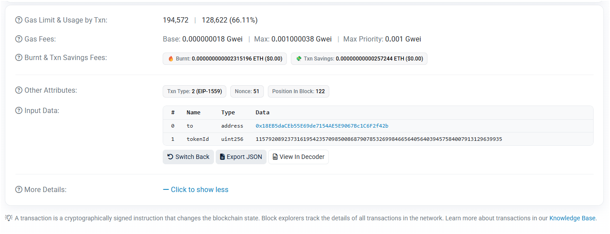
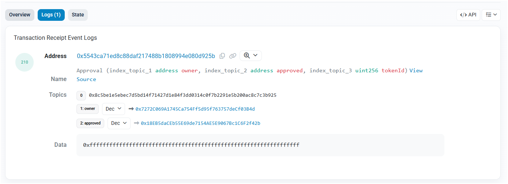

# Lab 05 — Ethereum accounts, gas & the EVM

## Lab 5.2 — Observed TrustKeys L1 output

- RPC: `https://l1testnet.trustkeys.network`
- Chain ID: `11968`
- Observed latest block: `717631`
- Latest `baseFeePerGas`: `8 wei`
- Average `gasUsedRatio` over the 20-block window: `0.90%`
- Projected next base fee: `8 wei`
- Verdict: `CHECK = OK`; the chain is quiet.

> The values above are live observations from `solutions/fee_history.py`; block numbers and fee values may change on a later run.

## Q1

`chainId` is included in the transaction data that is signed, as specified by EIP-155. Therefore, a signature created for one chain is not valid for replay on another chain with a different `chainId`, which provides protection against cross-chain replay attacks.[2]

## Q2

The target gas usage is 15 million, which is half of the 30-million gas limit. The observed average `gasUsedRatio` is only 0.90%, so the blocks are far below the target; EIP-1559 therefore applies a downward base-fee adjustment. Because the base fee is already only 8 wei, the integer-rounded decrease is effectively zero, so the base fee remains at the network floor until demand increases significantly.[3]

## Q3

For a request of `N` blocks, `gasUsedRatio` contains one value for each of those `N` blocks, while `baseFeePerGas` contains those `N` values plus the base fee calculated for the next block. A wallet can use the final element as a near-term base-fee estimate and set, for example, `maxFeePerGas` to that estimate plus the chosen `maxPriorityFeePerGas`, usually with an additional safety margin.[3]

## Lab 5.3 — Type-2 transaction fee decomposition

This section must use the real type-2 transfer sent on **TrustKeys L1**. The supplied Sepolia transaction below is a contract interaction for Lab 5.4, not the required 0.001-coin TrustKeys transfer.

Fill in the following after the TrustKeys transaction is mined:

```text
Transaction hash: <your TrustKeys transaction hash>
Transaction type: 2
Block number: <block number>
Gas used: <gas used>
Base fee: <base fee in wei>
Effective gas price: <effective gas price in wei>
Paid: gasUsed * effectiveGasPrice
Burned: gasUsed * baseFeePerGas
Tip: gasUsed * (effectiveGasPrice - baseFeePerGas)
Check: paid == burned + tip -> True
```

## Q4

Usually, no. The effective gas price is

```text
effectiveGasPrice = baseFee + min(maxPriorityFee, maxFee - baseFee)
```

If the original `maxFeePerGas` is already at least `baseFee + maxPriorityFeePerGas`, increasing only `maxFeePerGas` does not change the effective price; it only increases the maximum amount the sender is willing to pay. It can change the effective price only when the previous max fee was the limiting value.

For the supplied transaction, `baseFee = 18 wei`, `maxPriorityFeePerGas = 1,000,000 wei`, and `effectiveGasPrice = 1,000,018 wei`, which equals `18 + 1,000,000`.[1]

## Q5

A simple ETH transfer with empty calldata and no access list has an intrinsic gas cost of 21,000 gas. This is the base transaction-processing cost; contract execution or non-zero calldata would require additional gas.[3]

A failed transaction still consumes gas because the EVM has already used computational resources while executing it. The state changes are reverted, but the gas used is still charged; only unused gas can be returned, subject to the applicable refund rules.

## Lab 5.4 — Sepolia contract interaction

Transaction link: [Open the supplied transaction on Sepolia Etherscan](https://sepolia.etherscan.io/tx/0x51a3c957852d9533049694d0b48e7a6656169e8de729c86673d7fa119e7a0614)

Observed transaction details:

- Network: Sepolia
- Chain ID: `11155111`
- Status: successful
- Transaction type: `2 (EIP-1559)`
- Contract: `0x5543ca71ed8c88daf217488b1808994e080d925b`
- Function: `approve(address to, uint256 tokenId)`
- Function selector / MethodID: `0x095ea7b3`
- `to`: `0x18eb5daceb55e69de7154ae5e9067bc1c6f2f42b`
- `tokenId`: `115792089237316195423570985008687907853269984665640564039457584007913129639935` (`2^256 - 1`)

The transaction emitted an `Approval` event:

```text
Approval(address owner, address approved, uint256 tokenId)
owner:    0x7272C069A1745Ca754Ff5d95F763757deCf03B4d
approved: 0x18EB5daCEb55E69de7154AE5E9067Bc1C6F2f42b
tokenId: 2^256 - 1
```

### Required screenshots





## Q6

The EVM's dispatcher reads the first four bytes of calldata—the function selector, for example `0xa9059cbb` for `transfer(address,uint256)`—and routes execution to the corresponding function. Etherscan needs the contract ABI because the remaining bytes are ABI-encoded values, and the ABI provides the function signature, parameter types, and encoding rules needed to decode them.

> The supplied transaction uses `approve(address,uint256)`, so its actual selector is `0x095ea7b3`; the worksheet's `0xa9059cbb` value is the generic ERC-20 `transfer(address,uint256)` example.

## Sources

[1] [Supplied Sepolia transaction](https://sepolia.etherscan.io/tx/0x51a3c957852d9533049694d0b48e7a6656169e8de729c86673d7fa119e7a0614) — transaction fields, input data, and logs.

[2] [EIP-155 — Simple replay attack protection](https://eips.ethereum.org/EIPS/eip-155)

[3] [EIP-1559 — Fee market change for ETH 1.0 chain](https://eips.ethereum.org/EIPS/eip-1559)
